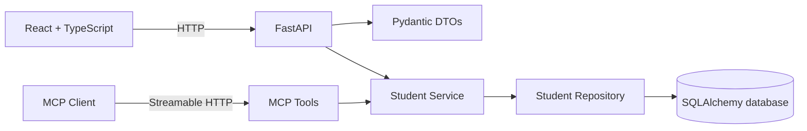

# Student Management

A full-stack student management application built with React and FastAPI. It provides a clean dashboard for managing student records, with a layered backend, validated REST API, and an additional MCP interface.

## Features

- Create, view, edit, and delete student records
- Search students by name and filter by grade
- View student totals, average age, and grade distribution
- Validate student data on the server: names, ages from 1 to 120, and grades from 1 to 6
- Access the same student operations through MCP tools
- Use SQLite by default, with database configuration through `DATABASE_URL`

## Technology

| Area | Technologies |
| --- | --- |
| Frontend | React 19, TypeScript 7, Vite 8 |
| Backend | Python 3.13+, FastAPI, Pydantic, Uvicorn |
| Data access | SQLAlchemy 2, SQLite by default |
| Additional interface | MCP Streamable HTTP |

## Project Structure

```text
Student-Management/
├── .vscode/
│   └── mcp.json                     # VS Code MCP connection configuration
├── StudentManagementPython/          # FastAPI backend
│   ├── app/
│   │   ├── api/                       # REST routes and dependency wiring
│   │   ├── core/
│   │   │   ├── dtos/                  # Request and response schemas
│   │   │   └── models/                # SQLAlchemy models
│   │   ├── implementation/services/   # Student business logic
│   │   ├── infrastructure/
│   │   │   ├── repositories/          # Database access
│   │   │   └── database.py            # Engine, sessions, table setup
│   │   ├── mcp/
│   │   │   ├── server.py              # MCP server instance
│   │   │   └── tools/                 # Student MCP tools
│   │   └── main.py                    # FastAPI app and lifecycle
│   ├── pyproject.toml
│   └── uv.lock
└── StudentManagementReact/           # React + TypeScript frontend
    ├── src/
    │   ├── api/                       # Backend HTTP client
    │   ├── components/                # Forms, lists, cards, statistics
    │   ├── styles/                    # App and component styles
    │   ├── types/                     # Shared TypeScript types
    │   ├── App.tsx                    # Main app and UI state
    │   └── main.tsx                   # React entry point
    ├── public/                        # Static assets
    ├── package.json
    └── vite.config.ts
```

## Architecture



The frontend is organized around focused components and a small API client. On the backend, API routes delegate to a service layer, which uses a repository for persistence. Pydantic DTOs validate and serialize API data. The REST API and MCP tools use the same service layer and database.

## Run Locally

Requirements: Python 3.13 or later, Node.js, and npm. Install [uv](https://docs.astral.sh/uv/) for the backend setup.

Start the backend from the repository root:

```sh
cd StudentManagementPython
uv sync
uv run uvicorn app.main:app --reload
```

In a second terminal, start the frontend:

```sh
cd StudentManagementReact
npm ci
npm run dev
```

Open the frontend URL printed by Vite (normally `http://localhost:5173`). The backend runs at `http://127.0.0.1:8000`; interactive API documentation is available at `http://127.0.0.1:8000/docs`.

The backend uses `sqlite:///./student_management.db` by default, relative to its working directory. To use a different SQLAlchemy database URL, set `DATABASE_URL` before starting the backend. The frontend currently targets `http://localhost:8000`.

## API

| Method | Endpoint | Description |
| --- | --- | --- |
| `GET` | `/api/health` | Health check |
| `GET` | `/api/students` | List students |
| `POST` | `/api/students` | Create a student |
| `GET` | `/api/students/{student_id}` | Get a student |
| `PATCH` | `/api/students/{student_id}` | Update student fields |
| `DELETE` | `/api/students/{student_id}` | Delete a student |

## MCP Integration

The backend exposes student operations to MCP-compatible clients through an [MCP](https://modelcontextprotocol.io/) server using Streamable HTTP at `http://127.0.0.1:8000/mcp`.

The MCP endpoint is hosted by the FastAPI backend, so start the backend first:

```sh
cd StudentManagementPython
uv run uvicorn app.main:app --reload
```

Then start the `my-mcp-server-bad273ff` entry in VS Code's `.vscode/mcp.json` using its **Start** action. That entry connects to the configured HTTP endpoint; it does not launch the backend process. Stop the backend terminal to stop the endpoint. There is no separate MCP server command in this project.

Available tools:

- `get_all_students` — list all student records
- `get_student_by_id` — retrieve a record by ID
- `create_student` — create a record with a name, age, and grade
- `update_student` — update the supplied fields for a record
- `delete_student` — delete a record by ID

The tools use the backend's student service and database, so changes made through MCP are reflected in the REST API and vice versa. The repository includes a VS Code MCP connection configuration at `.vscode/mcp.json`.

## Quality Checks

Run the frontend linter and production build from `StudentManagementReact/`:

```sh
npm run lint
npm run build
```

The build includes a TypeScript check. Database tables are created at backend startup.